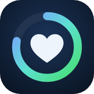

<p align="center">  </p>

# Health Balance

A self-hosted web app that tracks your **Biological Reserve Score**, a weekly estimate of your long-term health reserve, from your health data and gym log. Nothing is typed in.

- **Weekly score**: starts at 1000 and moves 12% toward a target each week, after an aging tax.
- **Markers**: VO2 max, waist-to-height, resting heart rate, HRV, blood pressure, cardio recovery.
- **Behaviours** (4-week average): sleep, steps, exercise, gym working sets, mindfulness.
- **History**: weekly breakdowns and daily trends.
- **AI insights**: a weekly summary written by Claude.

Tap **?** in the app for how the score is calculated.

## Setup

> [!IMPORTANT]
> The app has no login of its own, and that includes the ingest endpoint and any future API or MCP. It must only be reachable through a Cloudflare Tunnel protected by Cloudflare Access. Never add a `ports` section to the `app` service or otherwise expose it: anything that can reach the container directly can read and change all your data.

[docker-compose.yml](docker-compose.yml) runs the app next to `cloudflared`, which connects out to Cloudflare, so no port is opened on the server or your router.

1. In Cloudflare Zero Trust, go to **Networks → Tunnels**, create a tunnel and add a public hostname (e.g. `health.example.com`) with the service `http://health-balance:8080`.
2. Add an Access application for that hostname with a policy that only allows your own email address.
3. Next to [docker-compose.yml](docker-compose.yml), create a `.env`:
   ```bash
   TUNNEL_TOKEN=your_tunnel_token
   CLAUDE_NETWORK=the_network_your_claude_container_is_on
   ```
4. Run `docker compose up -d`.
5. Open `https://health.example.com`, log in through Access, add it to your Home Screen, and fill in your profile in **Settings**.

Other containers on the same Docker network can reach `http://health-balance:8080` without going through Access, so only run services you trust there.

| Variable | Default | Purpose |
| --- | --- | --- |
| `TUNNEL_TOKEN` | | Cloudflare Tunnel token (docker-compose.yml). |
| `CLAUDE_NETWORK` | | Docker network of the Claude Code container (docker-compose.yml). |
| `CLAUDE_RUN_URL` | `http://claude:8080/run` in compose | Claude Code container endpoint; enables AI insights without an API key. |
| `CLAUDE_RUN_MODEL` | `opus` | Claude Code model alias for insights. |
| `ANTHROPIC_API_KEY` | | Alternative to `CLAUDE_RUN_URL`: insights via the Messages API. |
| `ANTHROPIC_MODEL` | `claude-opus-5-5` | Model when using `ANTHROPIC_API_KEY`. |
| `DB_PATH` | `./data/health.db` | Database file. |
| `PORT` | `8080` | Listen port. |

## Sending health data

Post your samples once a day. Send the last 7 days each time; days already stored are overwritten.

```
POST /api/ingest/health
Content-Type: application/json

{"rows": "KEY;value;unit;start;end;source\n…"}
```

One sample per line, up to 5 MB per request. `start` and `end` are ISO 8601 with a UTC offset, and a sample counts toward the date it starts on. Decimal commas are accepted. Sources whose name contains `watch` or `iphone` are grouped as watch and phone.

| KEY | Measure | Units | Daily value |
| --- | --- | --- | --- |
| `RHR` | Resting heart rate | count/min, bpm | latest |
| `VO2` | VO2 max | mL/(kg·min) | latest |
| `CR` | Cardio recovery | count/min, bpm | latest |
| `HRV` | Heart rate variability | ms | mean |
| `WEIGHT` | Weight | kg, g, lb | mean |
| `WAIST` | Waist | cm, mm, m, in | mean |
| `BPSYS` | Systolic blood pressure | mmHg | mean |
| `BPDIA` | Diastolic blood pressure | mmHg | mean |
| `STEPS` | Steps | count | sum* |
| `EXMIN` | Exercise | min, h, s | sum* |
| `SETS` | Gym working sets | count | sum* |
| `SLEEP` | Sleep stage segment | ignored | see below |
| `MIND` | Mindfulness session | ignored | sessions and minutes |

\* Summed per source; the source with the highest total is kept.

- `SLEEP`: the value is the stage (`inbed`, `asleep`, `core`, `deep`, `rem`, `awake`). A night counts toward the day you wake up; naps are ignored.
- `MIND`: the value is ignored.
- Summed and averaged metrics skip the oldest day of each request, which is usually incomplete.
- The response reports how many day values were stored, and up to 10 rejected lines with the reason.

### History

Older days can be posted the same way, in batches that overlap by one day. To load an Apple Health export instead, copy `export.xml` into `./data` and run:

```bash
docker exec health-balance ./backfill-health -export /app/data/export.xml -db /app/data/health.db
```

Options: `-from YYYY-MM-DD` (default `2021-10-01`), `-tz` (time zone for untagged records, default `Europe/Stockholm`), `-dry-run`.

## Hosting

Run `ghcr.io/agusespa/health-balance` (amd64 and arm64; tags `:X.Y.Z` and `:latest`).

Health Balance has no login of its own: Cloudflare Access is its only protection (see [Setup](#setup)). Send health data to it over the private Docker network, for example from an n8n container calling `http://health-balance:8080`, which needs no credentials. Requests that change data are refused (`403`) when a browser marks them as coming from another site, so a page you visit can't use your Access session to change your data; scripts and n8n aren't affected.

A sender outside that network, such as a phone posting directly, goes through Access with a **service token**: add a policy with the **Service Auth** action that allows it, and send its `CF-Access-Client-Id` and `CF-Access-Client-Secret` headers with every request.

## Data

Everything lives in `./data/health.db` (SQLite, WAL mode). With AI insights on, your profile, scores and daily values are sent to Claude.

Back up while running:

```bash
sqlite3 ./data/health.db ".backup '/path/to/backup.db'"
```

To restore, stop the app, copy the backup over `./data/health.db`, and start it again.
